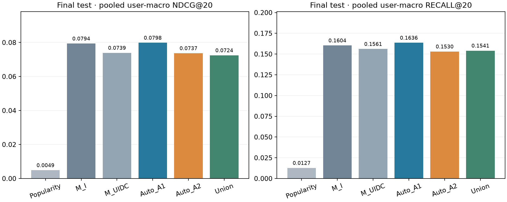

# Автоматическая генерация и отбор признаков для музыкальных рекомендаций

**Исследовательская работа 1.** Yambda-50M; ручные U/I/D/C признаки, ограниченная грамматика агрегатов и отбор для CatBoost. Эксперименты P001–P005 использованы для разработки, P006 — единственная итоговая временная оценка после фиксации метода.

Основной измеренный результат: pooled user-macro NDCG@20 Manual UIDC=0.073912, Auto A2=0.073679; парная разность -0.000233, описательный95% user-bootstrap интервал [-0.005676; +0.005172], пользователей 173. Улучшение A2 не установлено. Интервал, включающий ноль, не доказывает эквивалентность или отсутствие потери качества: допустимая граница потери заранее не задавалась. Это условная оценка выбранных когорт и протокола; результат не устанавливает качество на всей популяции.

## 1. Вопрос и исследовательская идея

Можно ли автоматизировать построение признаков без потери качества относительно содержательного ручного набора? Выбран путь автоматической генерации и отбора агрегатов. Программа разворачивает заданную человеком грамматику связей, сигналов, окон и операций, затем удаляет константы/дубли и выбирает поднабор на внутреннем временном holdout. Автоматизированы развёртка, вычисление, pruning и ограниченный отбор; грамматика и допустимые операции заданы исследователем. Это не система, самостоятельно открывающая произвольные SQL-запросы или новые сущности.

Успех задания не требует победы над бустингом. Проверяем качество, стоимость, чувствительность отбора и причины ограничений. Графовые модели и трансформеры в этой работе не исследуются.

## 2. Данные и единица предсказания

Источник — [Yambda](https://huggingface.co/datasets/yandex/yambda), опубликованный flat/multievent вариант50M, revision `dd6f3a19eef5866e346c3270e098baa641a44948`. Parquet footer содержит47 790 449 строк; UID-only проход дал10 000 UID. Используются uid,item_id,timestamp,event_type и связи item–artist/item–album. Все выбранные пользовательские истории сохранены внутри опубликованного файла; полнота относительно5B не доказана. KION загружен как допустимая альтернатива, но эксперименты этой работы используют Yambda.

Исходная когорта P001:64 равновероятно выбранных UID, seed20261025,318 157 событий и46 678 объектов. P005 добавляет две новые когорты64 с seed20261026/20261027; они исключают исходные64 и друг друга. Выбор UID выполнялся без фильтра по активности или качеству, обе новые membership были записаны до событийного анализа. В P006 используются те же192 выбранных UID; реальное число пользователей метрик определяется наличием test-запросов. Модели, каталоги и статистики строятся отдельно в каждой когорте, а pooled усредняет результаты пользователей.

Цель — один зарегистрированный listen в выбранный момент запроса. При нескольких listen одного UID с одинаковым timestamp группа исключается как неоднозначная. Это logged-target ranking; показов для CTR нет, а остальные кандидаты считаются неотмеченными объектами, не доказанными отрицательными реакциями. В train берутся только запросы с target в кандидатах; evaluation сохраняет все retrieval-пропуски как нулевые NDCG/Recall.

## 3. Временной протокол и доступная информация

| Период | RAW границы | Назначение |
| --- | --- | --- |
| Train | 9 752 280 ≤ t < 20 125 775 | Development fit |
| Validation | 20 125 775 ≤ t < 23 380 165 | Development оценка; после фиксации входит в final fit |
| Test | t ≥ 23 380 165 до конца опубликованной истории | Единственная итоговая оценка P006 |

Границы первоначально получены по timestamp-квантилям P001 и сохранены для новых когорт. RAW units не переводятся в дни или календарные даты. Перед запросом доступны только события timestamp<t; события одного времени не видят друг друга у всех пользователей. В оценочном периоде история обновляется предшествующими фактическими событиями — online replay. Target не передаётся генератору кандидатов и transform; признаки используют только uid, timestamp, candidate IDs и прошлое состояние.

Приняты явные допущения: событие доступно на logged timestamp; artist/album mapping — фиксированный snapshot. Временная доступность метаданных неизвестна. Итоговые played_ratio/track_length и текущий is_organic не используются. В P006 mapping каждой когорты сохраняется прежним, без расширения по test; неизвестные связи получают прежние defaults.

**Процедурное ограничение P001:** при вспомогательной проверке первого появления кандидатов verifier прочитал item_id/timestamp после p85. Test-метрики тогда не считались и эти строки не использовались для выбора метода; однако абсолютная изоляция всех test-полей не соблюдена. Это раскрыто в [исходной рецензии](../research/PILOT_RESULT_REVIEW.md). P006 labels/метрики открыты после отдельного протокола, input/source hashes, commit и тега.

## 4. Кандидаты и ручной baseline

Общий генератор P001:K100, popular25/repeat25/artist35/album15, недобор заполняется популярными. Каталог содержит только ранее наблюдавшиеся объекты данной когорты; target не вставляется. Popularity baseline ранжирует по прошлому числу listen, при равенстве по item_id ASC. Внутри сравнения признаков кандидаты одинаковы. Более успешный на development repeat-heavy P002 сюда не перенесён, чтобы изменение retrieval не смешивалось с эффектом признаков.

| Группа | Что рассчитано | Число основных признаков |
| --- | --- | ---: |
| U | Активность и типы событий пользователя, давность, all/short counts | 10 |
| I | Активность/популярность/давность объекта, степени artist/album mapping | 12 |
| D | История пары user–item, counts и давность | 10 |
| C | Профили user–artist и user–album; max/mean и known share | 34 |

Основной ручной контроль UIDC содержит66 столбцов. При нескольких связях C событие делит вклад между уникальными сущностями весом1/k. Доступны счётчики событий/listen/like/dislike; unlike/undislike влияют на общую активность и давность. Дополнительный наборX содержит26 признаков экспоненциального затухания. Raw user/item IDs в модель не подаются. CatBoostClassifier:120 итераций,depth5,learning_rate0.07,l2_leaf_reg5,Balanced,2 CPU-потока,seed20261025. Версии пакетов зафиксированы в [requirements-pilot.lock.txt](../requirements-pilot.lock.txt).

## 5. Грамматика и автоматический отбор

Грамматика состоит из206 детерминированных спецификаций. A1 —66 определений, побайтно воспроизводящих ручной UIDC. A2 расширяет пространство ещё140 определениями:56 оконных счётчиков,42 сглаженные доли,42 тренда. Обозначение Auto A2 в результатах означает поиск по всем206, а не только по140 новым. Окна201117/670390/2011171 RAW; короткое окно и half-life равны670390.

Для сигнала s и окна w применяются счётчики прошлого префикса, доля `(count_s + 0.5)/(count_events + 1)` и тренд `(current − previous)/(previous + 1)`, где previous=count(2w)−count(w). Для связей сначала вычисляется значение по каждой сущности, затем max/mean. Это доли типов событий, не CTR: показов нет. Неизвестная связь и отсутствующая история обрабатываются заданными defaults.

Inner cutoff —70-й процентиль train-query timestamps методом lower: fit<cutoff, selection≥cutoff, равные timestamps не делятся. Константы и точные дубли удаляются на inner fit; full fit даёт importance. Проверяются full/top8/top16/top32/top64/balanced32, одинаковые masks пропускаются. Выбор: user-macro NDCG20 на inner selection, далее меньше признаков и IDs. Не более6 fits на семейство и28 суммарно с финальными вариантами. Union сохраняет manual66 и добавляет выбранные внутри auto-выражения, кроме fit-дублей. Masks фиксируются до внешних predictions.

**Бюджеты поиска различаются:** настройки отдельного CatBoost одинаковы, но Auto получает дополнительные inner fits, а фиксированный Manual не получает равного числа попыток настройки. Поэтому вывод касается данной процедуры в указанном бюджете, не доказанного превосходства при равном поисковом бюджете. Полная стоимость генерации/поиска сообщается отдельно от финального обучения.

## 6. История development-экспериментов

### P001 — обязательный исходный пилот

Пилот проверил весь путь на64 UID:1349 train/499 validation запросов,52 validation-пользователя. Ниже исходные сохранённые результаты; они не заменены поздними пересчётами.

| Вариант P001 | Столбцов | NDCG20 | Recall20 |
| --- | ---: | ---: | ---: |
| B0_popularity | 1 | 0.007139 | 0.009615 |
| B1_I | 12 | 0.075981 | 0.158654 |
| B2_UI | 22 | 0.074114 | 0.154808 |
| B3_UID | 32 | 0.073940 | 0.168269 |
| B4_UIC | 56 | 0.072926 | 0.164423 |
| B5_UIDC | 66 | 0.075126 | 0.177885 |
| B6_IDC | 56 | 0.074954 | 0.168269 |
| B7_UDC | 54 | 0.074809 | 0.168269 |
| X1_UIDCX | 92 | 0.071435 | 0.175962 |
| A_window_201117 | 66 | 0.072316 | 0.164423 |
| A_window_2011171 | 66 | 0.070728 | 0.170192 |

I дал лучший пилотный NDCG, UIDC — Recall. X и альтернативные окна не улучшили primary. Retrieval нашёл130/499 целей, включая5/165 новых пользователю треков. Сквозное время198.517с,peak715.84MiB. [Полный P001](PILOT_001.md).

### P002 и P003 — ограничения и неудавшееся улучшение

P002 отдельно проверил retrieval: repeat-heavy нашёл153/499 целей против130/499, user-macro coverage0.297115 против0.252885. Новых целей4/165 против5/165; выигрыш относится к повторам. Время42.695с,peak197.38MiB. В P004–P006 этот генератор не использовался. [P002](P002_RETRIEVAL.md).

P003 подтвердил точное совпадение17 001 600 float32 ячеек, но оптимизированный replay оказался медленнее: 52.211с против23.411с baseline. Scale256 остановлен по бюджету:RSS1101.16MiB при1100, после1441/7728 feature queries. Матрица частичная и не использовалась для обучения. Этот отрицательный результат сохранён; успех64 не выдаётся за успешное масштабирование256. [P003](P003_FEATURE_PIPELINE.md).

### P004 и P005 — автоматизация и повторение

| Development выборка | Manual UIDC | Auto A1 | Auto A2 | Union | A1/A2 columns |
| --- | ---: | ---: | ---: | ---: | ---: |
| P004 | 0.075126 | 0.078346 | 0.078076 | 0.075126 | 16/8 |
| P005 seed26 | 0.062125 | 0.059630 | 0.062514 | 0.055797 | 62/197 |
| P005 seed27 | 0.062148 | 0.068576 | 0.064802 | 0.062148 | 8/64 |

В таблице NDCG20 user-macro. В P004 Auto поднял NDCG при меньшем Recall; Union=Manual. В P005 A1 меняет направление эффекта, A2 немного выше Manual в обеих когортах; Union хуже/равен. Отбор чувствителен к данным: A1 выбрал62/8, A2 —197/64. Jaccard выражений0.129/0.325. Финальные абляции включают I/UI/UID/UIC/UIDC/IDC/UDC, отдельные artist/album и исключение U/I/D/C из Union. Полные таблицы: [P004](P004_AUTO_FEATURES.md), [P005](P005_ROBUSTNESS.md). Влияние отдельных операторов грамматики причинно не изолировано; частота отбора не доказывает вклад.

## 7. P006 — итоговая временная оценка

До открытия test закреплены Auto A2 как основной исследуемый метод и Manual UIDC как контроль. Дополнительные фиксированные сравнения:Popularity,Manual I,Auto A1,Union. Используются прежние cohort-specific masks P004/P005, без нового выбора. Все сохранённые development train+validation blocks входят в final fit (условно на найденном target). Test:до10 однозначных listen-запросов на UID после23380165, query seeds20361025/26/27. Глобальный и per-cohort exclusive markers запрещают повторный запуск. Метод и72source/input hashes закреплены тегом `p006-frozen-before-test-2026-10-25` до score.

| Когорта | Test запросов / пользователей | UID без запросов | Fits | Время, с | Peak MiB |
| --- | ---: | ---: | ---: | ---: | ---: |
| p001 | 584 / 60 | 4 | 4 | 83.314 | 636.64 |
| p005_20261026 | 569 / 58 | 6 | 5 | 87.423 | 656.26 |
| p005_20261027 | 540 / 55 | 9 | 4 | 68.376 | 641.48 |

| Test набор | Когорта | Столбцов | NDCG20 user-macro | Recall20 user-macro |
| --- | --- | ---: | ---: | ---: |
| Popularity | p001 | 0 | 0.001298 | 0.003333 |
| M_I | p001 | 12 | 0.101275 | 0.188836 |
| M_UIDC | p001 | 66 | 0.096699 | 0.202884 |
| Auto_A1 | p001 | 16 | 0.104206 | 0.209550 |
| Auto_A2 | p001 | 8 | 0.101944 | 0.203836 |
| Union | p001 | 66 | 0.096699 | 0.202884 |
| Popularity | p005_20261026 | 0 | 0.006121 | 0.015517 |
| M_I | p005_20261026 | 12 | 0.058182 | 0.140394 |
| M_UIDC | p005_20261026 | 66 | 0.060659 | 0.143842 |
| Auto_A1 | p005_20261026 | 62 | 0.062047 | 0.143842 |
| Auto_A2 | p005_20261026 | 197 | 0.053978 | 0.124138 |
| Union | p005_20261026 | 201 | 0.056253 | 0.137931 |
| Popularity | p005_20261027 | 0 | 0.007423 | 0.020000 |
| M_I | p005_20261027 | 12 | 0.077792 | 0.150325 |
| M_UIDC | p005_20261027 | 66 | 0.063029 | 0.117922 |
| Auto_A1 | p005_20261027 | 8 | 0.071999 | 0.134286 |
| Auto_A2 | p005_20261027 | 64 | 0.063619 | 0.128052 |
| Union | p005_20261027 | 66 | 0.063029 | 0.117922 |
| **Popularity** | **pooled** | cohort-specific | **0.004862** | **0.012717** |
| **M_I** | **pooled** | cohort-specific | **0.079362** | **0.160352** |
| **M_UIDC** | **pooled** | cohort-specific | **0.073912** | **0.156079** |
| **Auto_A1** | **pooled** | cohort-specific | **0.079833** | **0.163593** |
| **Auto_A2** | **pooled** | cohort-specific | **0.073679** | **0.153023** |
| **Union** | **pooled** | cohort-specific | **0.072435** | **0.154097** |

Pooled даёт каждому представленному пользователю одинаковый вес, сначала усредняя его запросы. Это не среднее по номинальным192 и не объединённый каталог. Полные метрики@10/@20 и срезы сохранены в [analysis.json](p006_snapshot/analysis.json).

### Парные различия и неопределённость

| Контекст | Пользователей | ΔNDCG20 A2−Manual | Описательный95% интервал | ΔRecall20 | 95% интервал |
| --- | ---: | ---: | --- | ---: | --- |
| p001 | 60 | +0.005245 | [-0.006701;+0.018466] | +0.000952 | [-0.013810;+0.015952] |
| p005_20261026 | 58 | -0.006681 | [-0.012152;-0.001001] | -0.019704 | [-0.033498;-0.006897] |
| p005_20261027 | 55 | +0.000590 | [-0.008254;+0.008851] | +0.010130 | [-0.008831;+0.030909] |
| pooled | 173 | -0.000233 | [-0.005676;+0.005172] | -0.003055 | [-0.012223;+0.006441] |

Bootstrap:2000 выборок целых пользователей с возвращением,seed20261101,percentile quantiles linear. Парность сохраняется, tiny numerical deltas≤1e−12 нормализуются к0. Модели не переобучаются. Интервалы условны на выбранных когортax, методе и наблюдаемом периоде; не учитывают неопределённость выбора метода/когорт и не являются доказательством популяционной значимости.

Наблюдаемые pooled NDCG20 фиксированных контролей Auto A1 (0.079833) и Manual I (0.079362) выше, чем у основного A2. Это вторичные результаты; основной метод после просмотра test не заменяется. В когорте seed20261026 у A2 отрицательная разность NDCG20 к Manual (−0.006681); её development-маска содержит197 столбцов. Переобучение внутреннего отбора или шум — возможные объяснения, но причинная связь с числом признаков этим экспериментом не установлена.

### Retrieval и срезы

| Когорта | Целей в candidates / запросов | Новые: найдено / запросов | NDCG20 new Auto A2 |
| --- | ---: | ---: | ---: |
| p001 | 160 / 584 | 5 / 221 | 0.000000 |
| p005_20261026 | 123 / 569 | 2 / 210 | 0.002278 |
| p005_20261027 | 134 / 540 | 11 / 196 | 0.000000 |

Улучшение ranker не возвращает target, отсутствующий в candidates. Все пропуски и cold targets сохранены в знаменателе. Срезы repeat/new и warm/cold имеют собственные составы пользователей, поэтому их user-macro значения нельзя суммировать как доли pooled.

## 8. Стоимость, воспроизводимость и ограничения

На development auto206 replay стоил108.671с в P004 и118.075/113.944с в P005; baseline92 —24.072/21.174с в P005. Автоматизация расширила пространство и уменьшила ручной перебор, но вычисление206 признаков и внутренний поиск дороже фиксированного ручного набора. Peak P004678.77MiB, P005719.88/707.50MiB. Результаты отдельных запусков не измеряют стабильную производительность между машинами. VPS для64 не потребовалась; успешного результата256 нет.

Проверены причинные префиксы, ties, mapping, exact A1/manual values, splits, frozen selection, fit budgets, inputs/sources/outputs hashes. P006 independently recomputes все18 результатов при трёх успешных когортах, pooled метрики и bootstrap. Компактные ranks позволяют повторить проверку без датасетов и моделей; это не повтор обучения. [Воспроизведение](REPRODUCIBILITY.md), [snapshot P006](p006_snapshot/README.md), [протокол](../configs/P006_PROTOCOL.md), [preflight](../research/P006_REVIEW.md).

Ограничения: малые cohort-local каталоги и всего три связанные выборки одного датасета; одинаковый RAW горизонт всех репликаций; capped запросы; условное обучение на retrieved targets; нет exposure logs и калибровки CTR; неизвестны полнота50M относительно5B и временная доступность mapping; первоначальные границы опирались на timestamps P001 и был раскрытый audit exposure. Поисковый бюджет Auto больше фиксированного Manual. Отдельные операции, иные retrieval и большие когорты требуют новых development-экспериментов; текущий test после результатов не используется для подбора.

## 9. Выводы и дальнейшая работа

Реализована проверяемая автоматизация построения и отбора признаков, конкурирующая с ручным бустингом в пределах заданного протокола. Development показал изменение направления эффекта A1 и заметную нестабильность состава. Итоговая оценка выше сообщает фактический эффект A2 и его условную неопределённость; небольшие различия не превращаются в универсальное обещание качества. Union не гарантирует улучшения, а оптимизация replay и scale256 дали сохранённые отрицательные результаты.

Следующие исследовательские улучшения: источники новых кандидатов; отдельные абляции share/trend; экономное состояние признаков и масштабирование; дополнительные временные репликации. Это предложения, не выполненные эксперименты и не основание менять P006 после test.

## Источники, авторство и использование ИИ

1. [Исходное условие](../assignment.txt) — требования к работе.
2. [Yambda README закреплённой версии](https://huggingface.co/datasets/yandex/yambda/blob/dd6f3a19eef5866e346c3270e098baa641a44948/README.md) и локальный data/download_manifest.json — происхождение данных; [аудит семантики](../research/YAMBDA_SEMANTICS.md) разделяет документацию и неизвестные свойства.
3. Собственные P001–P006: протоколы, код, метрики, reviews и manifests по ссылкам отчёта. Непроверенные статьи из задания2 в обосновании работы1 не используются.

ИИ использовался для проектирования, реализации, синтетических проверок и сверки результатов; Luna субагенты готовили отдельные компоненты, основной агент интегрировал и проверял их. Проверка инструментами не является человеческой проверкой. Перед сдачей автор должен прочитать источники и воспроизвести ключевые проверки по [чек-листу](HUMAN_REVIEW.md); статус человеческой проверки остаётся «ожидается» в [SOURCES.md](../../SOURCES.md).
