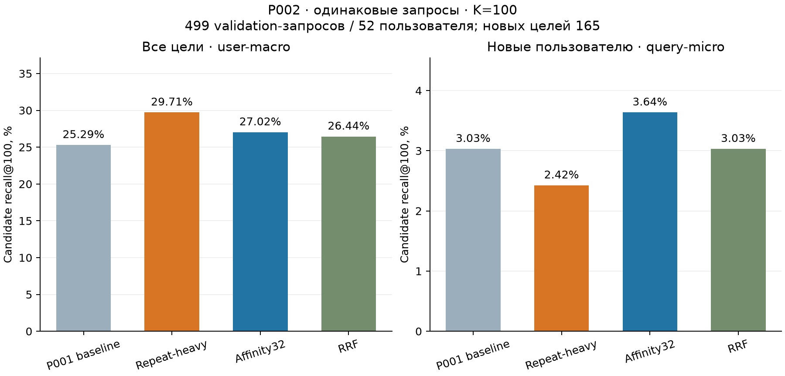

# P002 — диагностика генератора кандидатов

Дата: 25 октября 2026 года. Статус: завершён. **Development-эксперимент; бустинг не обучался, итоговый test не оценивался.**

Увеличение квоты повторных треков дало лучший candidate recall среди четырёх
заранее заданных вариантов: 153/499 против исходных 130/499, user-macro
29,7115% против 25,2885% (+4.4231 процентного пункта). Рост относится
к повторному потреблению: новые пользователю треки найдены в 4/165 запросов
против 5/165 у baseline. Поэтому этот вариант пока является кандидатом для
следующего сравнения, а проблема новых треков остаётся открытой.

## Что зафиксировано до результатов

Основание — [P001](PILOT_001.md), который сохраняется как отдельная обязательная
контрольная точка итогового отчёта. Протокол P002 закоммичен до выполнения:
`dc02423`; код исполнения — `dadc4eda6f93b7e7a62c8cf8c7ef2797ea074976`. [Протокол](../configs/P002_PROTOCOL.md),
[конфигурация](../configs/retrieval_002.json), [предварительная независимая проверка](../research/P002_REVIEW.md).

Сохранены точные 1 349 train и 499 validation-запросов P001 от той же когорты
64 пользователей. Метрики — только по 499 validation-запросам от 52 пользователей.
Все четыре варианта имеют K=100 и один и тот же доступный каталог.

| Вариант | Квоты popular/repeat/artist/album | Глубина профиля | Использование пулов |
| --- | --- | ---: | --- |
| Baseline | 25/25/35/15 | 5 | Первые 100 в каждом источнике, как P001 |
| Repeat-heavy | 10/60/20/10 | 5 | Те же source rankings и operational depth100 |
| Affinity32 | 10/20/50/20 | 32 | Первые100, более широкий профиль исполнителей/альбомов |
| RRF | Без квот | 5 | Ранговое объединение четырёх top200 pools, c=60 |

В RRF score(item) = сумма `1/(60 + rank)` по источникам, где item присутствует;
rank начинается с 1. Ничьи разрешаются по item ID. Недобор квот заполняется
популярностью; источники обходятся в фиксированном порядке. Target не передаётся
генератору; все четыре списка формируются до обращения к target-derived полям.
Число кандидатов каждого варианта — ровно 100 на каждом validation-запросе.

## Время, доступность и воспроизводимость baseline

Границы исходного времени P001 сохранены без пересчёта: train от 9 752 280
до 20 125 775, validation до 23 380 165. До преобразования данных в Python
применён Arrow batch-фильтр `timestamp < 23 380 165`; дальнейший replay
подаёт генератору только строки `timestamp < query_timestamp`. В Python загружены
270,429 development-событий, до последнего запроса
наблюдены 270,367. Объекты и отзывы из будущего в кандидаты не добавляются.

Baseline совпал с P001 **по точной последовательности item ID на всех
1,848 запросах**. Repeat/new и warm/cold также
сверены с историей до запроса. Хеши query file и трёх prepared inputs совпали
с сохранённой P001 контрольной точкой. Исходные результаты P001 сохранены.

Документация Yambda описывает гранулярность 5 секунд, но эпоха, календарный
период, способ построения 50M и полнота относительно 5B не установлены;
используется raw timestamp. Фиксированный mapping snapshot и доступность
logged events по timestamp остаются допущениями. [Проверяемые цитаты и пробелы](../research/YAMBDA_SEMANTICS.md).

## Результаты retrieval

User-macro — сначала среднее попаданий внутри пользователя, затем между
пользователями; query-micro — доля найденных целей во всех 499 запросах.
В знаменателе остаются misses и 70 cold targets; cold recall у всех вариантов 0.
Повторные/новые цели — разбиение относительно конкретного пользователя;
warm/cold — относительно доступного каталога когорты.

| Вариант | Найдено | User-macro recall | Query-micro recall | Повторные | Новые пользователю |
| --- | ---: | ---: | ---: | ---: | ---: |
| P001 baseline | 130/499 | 25.2885% | 26.0521% | 125/334 | 5/165 |
| Repeat-heavy | 153/499 | 29.7115% | 30.6613% | 149/334 | 4/165 |
| Affinity32 | 139/499 | 27.0192% | 27.8557% | 133/334 | 6/165 |
| RRF | 136/499 | 26.4423% | 27.2545% | 131/334 | 5/165 |

В парном сравнении Repeat-heavy нашёл цели в 25 запросах, где baseline
промахнулся, и потерял 2 baseline-попадания: чистый прирост 23. Пользователей
с ростом/равенством/снижением среднего recall — 17/33/2 из 52. Это
описательные разницы; доверительные интервалы и значимость не рассчитывались.



Масштабы осей двух панелей графика разные. Affinity32 дал небольшое увеличение
общего покрытия и 6 новых целей вместо 5. Он одновременно меняет квоты и
глубину профиля, поэтому приписывать эффект одному расширению профиля нельзя.
RRF дал 136 попаданий — меньше Repeat-heavy; это результат заданной формулы,
глубины и единственной когорты, а не вывод о ранговом объединении вообще.

## Где теряются цели

Ниже число targets, встречающихся в source pool до квот, с общим знаменателем
499. Цель может находиться в нескольких источниках; складывать столбцы нельзя.

| Источник | Baseline top100 | Baseline top200 | Affinity32 top100 | Affinity32 top200 |
| --- | ---: | ---: | ---: | ---: |
| popular | 16 | 34 | 16 | 34 |
| repeat | 167 | 201 | 167 | 201 |
| artist | 58 | 69 | 71 | 114 |
| album | 26 | 26 | 79 | 94 |

Объединение baseline top200-пулов содержит 231/499 целей, Affinity32 top200 —
256/499. Это диагностическое покрытие объединённого пула переменного размера,
а не качество списка из 100 рекомендаций. Квоты и ранжирование пула теряют
часть уже доступных целей; другие цели отсутствуют даже в объединении пулов.

Для новых пользователю треков даже объединение top200-пулов покрывает только
13/165 целей baseline и 19/165 Affinity32. Значит, одна перестановка квот
не решает задачу новых треков: нужно отдельно улучшать сами источники кандидатов
и проверять доступность объектов. Это наблюдение по этой когорте, а не готовый
вывод о качестве следующего метода.

Фактические уникальные добавления в shortlist после дедупликации:

| Источник первого отбора | Baseline: среднее объектов | Baseline: целей | Repeat-heavy: среднее объектов | Repeat-heavy: целей |
| --- | ---: | ---: | ---: | ---: |
| album | 12.75 | 7 | 9.06 | 4 |
| artist | 34.88 | 16 | 19.90 | 9 |
| popular | 25.00 | 6 | 10.00 | 5 |
| popular_fallback | 2.87 | 0 | 2.91 | 0 |
| repeat | 24.50 | 101 | 58.13 | 135 |

Attribution означает первый источник в фиксированном порядке квот;
это не причинный вклад источника. Например, один трек может присутствовать
и в repeat, и в artist. В RRF уникальное авторство источника не назначается:
сохраняются memberships и score contributions через исходные ranks.
Средние pairwise overlaps depth200 сохранены в метриках, полные пулы — локально.

## Ресурсы и сохранённые доказательства

Сквозной runner: **42.695 с**, peak process memory
**197.38 МиБ**, минимум свободной системной
RAM **2146.05 МиБ**. Пороги
1 100/150 МиБ не нарушены. Фильтрация/загрузка 1.555 с,
replay с записью diagnostics 39.495 с.
VPS для P002 не потребовалась. Этот retrieval-only замер не сопоставим напрямую
со временем/памятью полного feature+boosting P001.

Полные candidate records занимают 165.52 МиБ,
evaluation rows — 1.07 МиБ.
Они сохранены локально в `artifacts/retrieval_002/`; компактные метрики,
протокол и хеши — в Git. Source pool cache разделяется между стратегиями:
индивидуальные generation timers зависят от порядка вызова и не являются
независимыми бенчмарками вариантов.

39 синтетических тестов прошли до запуска, включая mixed-rowgroup sentinel,
exact baseline на искусственном примере, RRF hand example, user-macro,
fallback attribution и сохранение misses. [Независимая проверка результатов](../research/P002_RESULT_REVIEW.md)
и [пересчёт](../research/P002_RECHECK.json) описывают фактическую проверку outputs.

## Ограничения и дальнейшее решение

Это четыре заранее заданных development-варианта, выбранный capped query sample,
одна когорта и один seed. Итоговый test не оценивался; статистическая устойчивость
и качество ранжирования на новых кандидатах не установлены. Датасет содержит
наблюдаемые действия, а не полный эксперимент с экспозициями. Human verification
не объявляется выполненной: [реестр источников](../../SOURCES.md).

Для следующего этапа Repeat-heavy можно принять как development-кандидат
для общей retrieval-конфигурации, сохранив отдельный анализ новых треков.
Перед увеличением когорты нужно измерить и оптимизировать построение признаков.
Затем сравнить ручные/автоматические признаки на **одинаковых** кандидатах и
временных границах. Рост retrieval здесь не является ростом NDCG и не является
доказательством преимущества автоматизации признаков. P001 и P002 оба войдут
в итоговый отчёт как последовательные этапы исследования.

## Команды и файлы

Из корня проекта с сохранёнными входами P001 и установленными зависимостями:

```powershell
.\.venv\Scripts\python.exe -m unittest discover -s task_01_auto_features/tests -p 'test_*.py' -q
.\.venv\Scripts\python.exe -u task_01_auto_features/src/run_retrieval.py
.\.venv\Scripts\python.exe task_01_auto_features/src/report_retrieval.py
```

Runner отказывается перезаписывать завершённый или непустой output: повторный
опыт получает отдельный каталог/ID с указанием причины. Отчёт можно пересоздать
после clone по компактной копии метрик, без чтения event-данных и обучения.

- [Замороженные метрики и хеши](p002_snapshot/metrics.json), [CSV](p002_metrics.csv), [SVG](p002_comparison.svg).
- [Контрольная точка P002](p002_snapshot/README.md); локальные raw records не входят в clone.
- SHA256 исходного metrics JSON: `99b4a433f2ade6ee7a28df2be370e8f3fe3a5e7c853bd2d79e5487de5a5b6332`.
