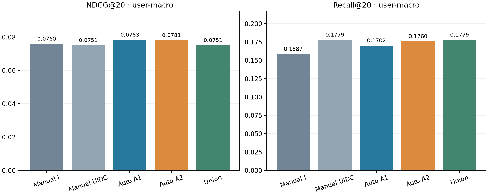

# P004 — автоматическое построение и отбор признаков

Ограниченный поиск завершён на фиксированной когорте64. Ниже измеренное development-сравнение; итоговый test не оценивался.

## Условия и метод

Те же 1 848 запросов P001 и прежние K=100 кандидатов; параметры retrieval P002 сюда не переносились. Цель — следующий зарегистрированный listen; события доступны строго раньше query. Mapping — фиксированный snapshot с неизвестной временной доступностью. Полнота Yambda-50M относительно5B не доказана. Внешняя validation уже использовалась ранее: это повторное development-сравнение, не независимый test.

Сгенерировано 206 выражений: 66 A1 повторяют семантику ручного UIDC, 140 A2 добавляют окна, сглаженные доли и тренды. A1 совпал с ручной матрицей побитно во всех 12 196 800 ячейках. Грамматика задана человеком; программно выполняются её развёртка и отбор.

Inner cutoff=17870780 RAW: 943 fit queries и 406 selection queries. Внешняя оценка — 499 запросов от 52 пользователей. Константы/дубли, importance и выбор поднабора используют только inner fit/selection. Все внешние masks сохранены до внешних predictions.

A1 ищет в тех же определениях, что Manual; A2 — во всех206 выражениях. После full fit проверяются top8/16/32/64 и balanced32 с пропуском одинаковых masks. Primary score — inner user-macro NDCG@20; ничьи: меньше признаков, затем IDs. Все модели CatBoost120/depth5/lr.07, два потока, один seed. Auto использует дополнительный поисковый бюджет; фиксированный Manual не получает равного числа попыток.

## Отбор до внешней оценки

- A1: после pruning 56 колонок; выбран `inner_A1_top16`, 16 признаков, inner NDCG@20=0.108675.
- A2: после pruning 176 колонок; выбран `inner_A2_top8`, 8 признаков, inner NDCG@20=0.096214.

Для Union выбрана `inner_A1_top16` по внутреннему критерию. Manual66 сохраняется целиком; дополнительные точные дубли удалены на inner fit. Итог Union — 66 признаков.

A1 top64 совпал с full после pruning, balanced32 совпал с top32; A2 balanced32 также совпал с top32. Поэтому фактически выполнены четыре A1 и пять A2 inner fits, а не все12 разрешённых попыток.

Выбранные A2 выражения (4 из8 являются новыми относительно ручного набора):

| Expression ID | Группа | Операция | Окно RAW |
| --- | --- | --- | --- |
| `u_events_short` | U | count | short |
| `u_listen_short` | U | count | short |
| `i_last_age` | I | age | None |
| `d_last_age` | D | age | None |
| `d_events_w2011171` | D | count | 2011171 |
| `c_album_events_w2011171_mean` | C | count | 2011171 |
| `d_listen_share_all` | D | share | all |
| `c_artist_events_trend_w2011171_max` | C | trend | 2011171 |

## Внешние результаты

| Набор | Признаков | NDCG@20 user-macro | Recall@20 user-macro |
| --- | ---: | ---: | ---: |
| M_I | 12 | 0.075981 | 0.158654 |
| M_UI | 22 | 0.074114 | 0.154808 |
| M_UID | 32 | 0.073940 | 0.168269 |
| M_UIC | 56 | 0.072926 | 0.164423 |
| M_UIDC | 66 | 0.075126 | 0.177885 |
| M_IDC | 56 | 0.074954 | 0.168269 |
| M_UDC | 54 | 0.074809 | 0.168269 |
| M_UID_Cartist | 49 | 0.076411 | 0.168269 |
| M_UID_Calbum | 49 | 0.075377 | 0.170192 |
| Auto_A1 | 16 | 0.078346 | 0.170192 |
| Auto_A2 | 8 | 0.078076 | 0.175962 |
| Union | 66 | 0.075126 | 0.177885 |
| Union_without_U | 56 | 0.074954 | 0.168269 |
| Union_without_I | 54 | 0.074809 | 0.168269 |
| Union_without_D | 56 | 0.072926 | 0.164423 |
| Union_without_C | 32 | 0.073940 | 0.168269 |

Все варианты имеют те же retrieval-пропуски: цель найдена в 130/499 запросов. Repeat/new знаменатели: 334/165. Остальные кандидаты считаются unmarked, а не подтверждёнными отрицательными реакциями. Обучение условно на train-запросах с найденной целью; на evaluation все пропуски сохраняются с нулевым качеством.

## Парные различия относительно Manual UIDC

- Auto_A1: средняя user-level разность NDCG@20=+0.003219; пользователей с ростом/снижением/равенством: 19/14/19.
- Auto_A2: средняя user-level разность NDCG@20=+0.002949; пользователей с ростом/снижением/равенством: 17/16/19.
- Union: средняя user-level разность NDCG@20=+0.000000; пользователей с ростом/снижением/равенством: 0/0/52.

Эти различия не доказывают устойчивое превосходство: малая когорта, один seed, повторная development-оценка и ограниченный retrieval. Manual I остаётся дополнительным фиксированным сильным контролем; primary comparator — Manual UIDC. Различие A2 относительно A1 смешивает расширение языка с отбором; вклад отдельных операций отдельно не установлен.

Относительно Manual UIDC: AutoA1 NDCG@20 выше на 4.29% при снижении Recall@20 на 0.007692; AutoA2 NDCG@20 выше на 3.93%. Union равен Manual: выбранный внутри AutoA1 не добавляет новых определений. Расширенный язык A2 в этом опыте не превзошёл A1 по основному NDCG, хотя дал близкий Recall. Это сохраняем как ограничение, а не объявляем общим выигрышем автоматизации.

## Стоимость и проверки

Фактических fits: 20 из лимита28 (9 inner, 11 final). Одинаковые final masks переиспользуют модель и predictions; их fit time в таблице относится к исходному fit и не суммируется повторно.

Полный runner 160.273 с; feature replay 108.671 с; отбор 25.512 с; peak RSS 678.77 МиБ, минимум свободной системной памяти 986.31 МиБ. Матрица184800×206 float32: 145.221 МиБ значений. Это стоимость всего метода на64; успешный scale256 этим не подтверждается.

Независимый verifier пересчитал метрики из scores для всех25 результатов: 9 inner и16 final, включая переиспользованные masks. Все overall/strata метрики совпали с точностью1e-12; проверены74 output hashes и17 source/input/config/protocol hashes. Синтетический набор —75 тестов. Компактная таблица рангов позволяет повторно пересчитать метрики после clone без датасетов и моделей: отдельная копия с41 файлом evidence и двумя verifier-скриптами прошла пересчёт25результатов по11 638 rank rows. Это проверка сохранённых рангов, не повтор обучения или feature replay.

[Протокол до запуска](../configs/P004_PROTOCOL.md), [конфигурация](../configs/p004_auto.json), [preflight](../research/P004_REVIEW.md), [независимая проверка](../research/P004_RESULT_REVIEW.md), [компактные доказательства](p004_snapshot/README.md). [CSV метрик](p004_metrics.csv), [парные query differences](p004_paired_queries.csv), [парные user differences](p004_paired_users.csv).

Проверка компактных доказательств: `.\.venv\Scripts\python.exe task_01_auto_features/src/verify_auto_snapshot.py`. Локальный verifier scores: `verify_auto_checkpoint.py --output artifacts/p004_auto64/verification_RECHECK.json`; исходный verification output не перезаписывается. Повторный запуск обучения требует нового `--output`; результаты P001–P004 не перезаписываются. Источники не отмечены проверенными человеком без подтверждения пользователя. Работа2 ещё не начата.
