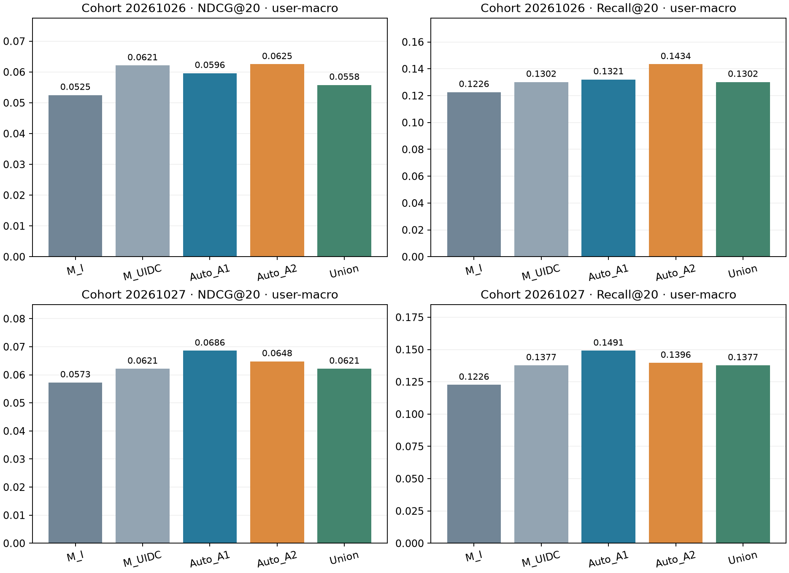

# P005 — устойчивость автоматического отбора на новых когортах

Две заранее выбранные непересекающиеся development-когорты; результаты и неудачи сохраняются без повторного отбора. Итоговый test не оценивался.

Измеренные ΔNDCG20 относительно ManualUIDC в порядке когорт20261026/20261027: Auto_A1: -0.002495 / +0.006428; Auto_A2: +0.000389 / +0.002654; Union: -0.006329 / +0.000000. Состав отобранных наборов зависит от когорты; устойчивое популяционное преимущество не установлено.

## Метод и границы интерпретации

До обработки событий обе membership заморожены после UID-only прохода опубликованного Yambda-50M. Исключены все64 пользователя P001/P004; затем uniform random.sample выбрал64 UID с seed20261026 и64 с seed20261027 из оставшихся UID. Нет фильтра по активности или качеству. Это две условные выборки из одной конечной популяции, а не независимые наборы данных. Полные опубликованные истории сохранены; Arrow удаляет timestamp>=23380165 до Python payload/statistics. Полнота50M относительно5B и временная доступность mapping не доказаны.

RAW границы P001 сохранены: train queries от9752280 до20125775, внешняя validation до23380165. До30 train/10 validation запросов на пользователя; неоднозначные группы listen исключаются. История строго раньше запроса, включая обработку ties. Original P001 candidates K100 (popular25/repeat25/artist35/album15), target не вставляется. Retrieval P002 не переносился. Каждая когорта имеет свой query sampling seed; общий model seed20261025.

Грамматика206 и алгоритм отбора P004 закреплены source hashes: A1=66 ручных UIDC, A2 ищет во всех206 выражениях, включая140 дополнительных окон/долей/трендов. Inner split — train timestamp p70 lower, ties не разделяются; pruning/importance используют fit, поднабор выбирается на inner selection. Full/top8/16/32/64/balanced32 с dedup; максимум6 fits на семейство,28 total. Все финальные masks замораживаются до внешнего scoring. Manual I — дополнительный фиксированный контроль, primary comparator — Manual UIDC. CatBoost120/depth5/lr.07/l2=5/Balanced/2threads. Автоматический метод расходует дополнительный бюджет поиска; Manual не получает равного числа попыток.

## Результаты отдельно по когортам

### Когорта 20261026

Полная история 321,247 строк; development 277,258. Запросов train 1517, validation 514 от 53 пользователей. Inner cutoff 18051915: 1061 fit / 456 selection. A1 побайтно совпал с manual во всех 13,404,600 float32 ячейках до обучения.

| Набор | Столбцов | NDCG@20 user-macro | Recall@20 user-macro |
| --- | ---: | ---: | ---: |
| M_I | 12 | 0.052514 | 0.122642 |
| M_UI | 22 | 0.052151 | 0.115094 |
| M_UID | 32 | 0.053963 | 0.130189 |
| M_UIC | 56 | 0.058890 | 0.130189 |
| M_UIDC | 66 | 0.062125 | 0.130189 |
| M_IDC | 56 | 0.055264 | 0.126415 |
| M_UDC | 54 | 0.059737 | 0.130189 |
| M_UID_Cartist | 49 | 0.056556 | 0.120755 |
| M_UID_Calbum | 49 | 0.059552 | 0.118868 |
| Auto_A1 | 62 | 0.059630 | 0.132075 |
| Auto_A2 | 197 | 0.062514 | 0.143396 |
| Union | 201 | 0.055797 | 0.130189 |
| Union_without_U | 171 | 0.056444 | 0.133962 |
| Union_without_I | 169 | 0.067344 | 0.137736 |
| Union_without_D | 171 | 0.053027 | 0.122642 |
| Union_without_C | 92 | 0.055849 | 0.128302 |

Retrieval: 116/514 целей в кандидатах; candidate recall user-macro 0.226415. Repeat/new/cold запросов 335/179/63. Во всех оценках пропуски retrieval остаются нулями. Обучение условно на найденных целях; остальные кандидаты — unmarked, не доказанные отрицательные реакции.

Срезы по user-macro NDCG20 (внутри каждого среза усредняются только представленные там пользователи):

| Срез | Запросов / пользователей | Manual UIDC | Auto A1 | Auto A2 | Union |
| --- | ---: | ---: | ---: | ---: | ---: |
| repeat | 335 / 50 | 0.101645 | 0.099726 | 0.105220 | 0.092917 |
| new | 179 / 49 | 0.000000 | 0.000000 | 0.000000 | 0.000000 |
| warm | 451 / 53 | 0.068741 | 0.067048 | 0.070224 | 0.063459 |
| cold | 63 / 33 | 0.000000 | 0.000000 | 0.000000 | 0.000000 |

- A1: выбран `inner_A1_full`, 62 столбцов (0 новых относительно manual определений), inner NDCG20=0.061152.
- A2: выбран `inner_A2_full`, 197 столбцов (135 новых относительно manual определений), inner NDCG20=0.061677.

Union использует `inner_A2_full` по внутреннему критерию; 201 столбцов после добавления к manual66 и удаления fit-дублей.

В финальном обучении используются 330/1517 train-запросов с найденной целью (33,000 candidate rows). Это ограничение условного обучения сохраняется для всех наборов признаков.

- Auto_A1 против ManualUIDC: ΔNDCG20=-0.002495, ΔRecall20=+0.001887; пользователей рост/снижение/равенство 12/14/27.
- Auto_A2 против ManualUIDC: ΔNDCG20=+0.000389, ΔRecall20=+0.013208; пользователей рост/снижение/равенство 16/16/21.
- Union против ManualUIDC: ΔNDCG20=-0.006329, ΔRecall20=-0.000000; пользователей рост/снижение/равенство 17/15/21.

Стоимость child вместе с подготовкой: 248.439 с; baseline replay 24.072 с, auto replay 118.075 с; 25/28 фактических fits, peakRSS 719.88 МиБ, минимум свободной RAM 1215.88 МиБ. Матрица 203100×206, 159.60 МиБ.

### Когорта 20261027

Полная история 285,925 строк; development 238,549. Запросов train 1397, validation 518 от 53 пользователей. Inner cutoff 18682880: 977 fit / 420 selection. A1 побайтно совпал с manual во всех 12,639,000 float32 ячейках до обучения.

| Набор | Столбцов | NDCG@20 user-macro | Recall@20 user-macro |
| --- | ---: | ---: | ---: |
| M_I | 12 | 0.057262 | 0.122642 |
| M_UI | 22 | 0.056114 | 0.122642 |
| M_UID | 32 | 0.060676 | 0.132075 |
| M_UIC | 56 | 0.061214 | 0.139623 |
| M_UIDC | 66 | 0.062148 | 0.137736 |
| M_IDC | 56 | 0.059253 | 0.132075 |
| M_UDC | 54 | 0.062943 | 0.143396 |
| M_UID_Cartist | 49 | 0.062249 | 0.137736 |
| M_UID_Calbum | 49 | 0.062914 | 0.135849 |
| Auto_A1 | 8 | 0.068576 | 0.149057 |
| Auto_A2 | 64 | 0.064802 | 0.139623 |
| Union | 66 | 0.062148 | 0.137736 |
| Union_without_U | 56 | 0.059253 | 0.132075 |
| Union_without_I | 54 | 0.062943 | 0.143396 |
| Union_without_D | 56 | 0.061214 | 0.139623 |
| Union_without_C | 32 | 0.060676 | 0.132075 |

Retrieval: 111/518 целей в кандидатах; candidate recall user-macro 0.209434. Repeat/new/cold запросов 309/209/57. Во всех оценках пропуски retrieval остаются нулями. Обучение условно на найденных целях; остальные кандидаты — unmarked, не доказанные отрицательные реакции.

Срезы по user-macro NDCG20 (внутри каждого среза усредняются только представленные там пользователи):

| Срез | Запросов / пользователей | Manual UIDC | Auto A1 | Auto A2 | Union |
| --- | ---: | ---: | ---: | ---: | ---: |
| repeat | 309 / 48 | 0.104954 | 0.115693 | 0.110506 | 0.104954 |
| new | 209 / 51 | 0.000000 | 0.000000 | 0.000000 | 0.000000 |
| warm | 461 / 53 | 0.068128 | 0.075403 | 0.071214 | 0.068128 |
| cold | 57 / 33 | 0.000000 | 0.000000 | 0.000000 | 0.000000 |

- A1: выбран `inner_A1_top8`, 8 столбцов (0 новых относительно manual определений), inner NDCG20=0.056770.
- A2: выбран `inner_A2_top64`, 64 столбцов (49 новых относительно manual определений), inner NDCG20=0.052571.

Union использует `inner_A1_top8` по внутреннему критерию; 66 столбцов после добавления к manual66 и удаления fit-дублей.

В финальном обучении используются 336/1397 train-запросов с найденной целью (33,600 candidate rows). Это ограничение условного обучения сохраняется для всех наборов признаков.

- Auto_A1 против ManualUIDC: ΔNDCG20=+0.006428, ΔRecall20=+0.011321; пользователей рост/снижение/равенство 17/17/19.
- Auto_A2 против ManualUIDC: ΔNDCG20=+0.002654, ΔRecall20=+0.001887; пользователей рост/снижение/равенство 17/15/21.
- Union против ManualUIDC: ΔNDCG20=+0.000000, ΔRecall20=+0.000000; пользователей рост/снижение/равенство 0/0/53.

Стоимость child вместе с подготовкой: 202.006 с; baseline replay 21.174 с, auto replay 113.944 с; 20/28 фактических fits, peakRSS 707.50 МиБ, минимум свободной RAM 1385.98 МиБ. Матрица 191500×206, 150.49 МиБ.



## Устойчивость и выбранные выражения

- Auto_A1: ΔNDCG20 к ManualUIDC по когортам: 20261026: -0.002495, 20261027: +0.006428.
- Auto_A2: ΔNDCG20 к ManualUIDC по когортам: 20261026: +0.000389, 20261027: +0.002654.
- Union: ΔNDCG20 к ManualUIDC по когортам: 20261026: -0.006329, 20261027: +0.000000.
- A1: пересечение 8, объединение 62 выбранных expressions; Jaccard 0.1290.
- A2: пересечение 64, объединение 197 выбранных expressions; Jaccard 0.3249.

Частота выбора не доказывает причинный вклад признака. Состав и размер набора могут меняться вместе с когортой; малые разности на двух development-выборках не устанавливают популяционное превосходство. A2 против A1 одновременно меняет язык и выбранный поднабор; вклад отдельных операций здесь не изолирован. Общие ограничения: небольшой локальный каталог, одинаковые RAW временные интервалы всех репликаций, неизвестная полнота историй, фиксированный mapping snapshot и ограниченное покрытие retrieval.

P004 остаётся исторической development reference: ManualUIDC NDCG20=0.075126, A1=0.078346, A2=0.078076; Union=Manual. P005 показывает, повторяется ли направление этих различий при новом UID sampling, без переопределения метода после внешних метрик. P001 обязательно войдёт в итоговый отчёт; P003 scale256 остаётся failed и не заменяется успешными64.

## Проверка и воспроизведение

Независимая проверка parent: `verified`, когорт 2. Verifier читает predictions/queries и пересчитывает метрики с item-ID tie break, проверяет временные split, selection, aliases, budgets и SHA256 inputs/sources/outputs. Компактный snapshot сохраняет rank evidence; проверка его rank table не означает повторного обучения или повторной проверки исходных scores.

```powershell
.venv\Scripts\python.exe task_01_auto_features/src/run_robustness.py --output task_01_auto_features/artifacts/p005_new_run
.venv\Scripts\python.exe task_01_auto_features/src/verify_robustness_checkpoint.py --run artifacts/p005_new_run
.venv\Scripts\python.exe task_01_auto_features/src/report_robustness.py --run task_01_auto_features/artifacts/p005_new_run
.venv\Scripts\python.exe task_01_auto_features/src/verify_robustness_snapshot.py
```

Конфигурация: [p005_robustness.json](../configs/p005_robustness.json); [протокол](../configs/P005_PROTOCOL.md); [preflight](../research/P005_REVIEW.md); [компактная контрольная точка](p005_snapshot/README.md). CSV: [все варианты](p005_metrics.csv), [парные пользователи](p005_paired_users.csv), [парные запросы](p005_paired_queries.csv), [выражения](p005_selected_expressions.csv).

Результат проверки из изолированной копии без датасетов и predictions: [portable verification](p005_portable_verification.json). Методическая сверка итогов: [result review](../research/P005_RESULT_REVIEW.md).

Следующий этап — зафиксировать итоговый метод и отдельный протокол test с учётом всех development-результатов; не выбирать новые параметры по тесту. Работа2 начнётся после завершения работы1.
