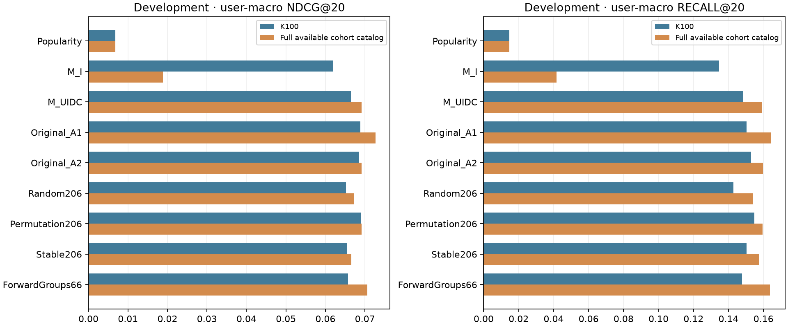

# P007 — новые способы отбора признаков и оценка полного каталога

**Дополнение к работе 1; исследовательская development-оценка.** Все 1 531 прежних validation-запроса трёх непересекающихся когорт по 64 пользователя; полный каталог — все наблюдавшиеся до запроса объекты соответствующей когорты. Этот этап не охватывает всех 10 000 пользователей/50M событий Yambda и не является новым независимым test. P006 сохранён без изменений.

## Что сравнивается

| Метод | Принцип |
| --- | --- |
| Popularity | Прошлое число прослушиваний трека |
| M_I / M_UIDC | Фиксированные 12 признаков трека /66 ручных U/I/D/C |
| Original_A1 / Original_A2 | Прежние masks P004/P005 из 66/206 выражений, без переотбора |
| Random206 | Десять случайных поднаборов 8/16/32/64/128, выбор по inner NDCG20 |
| Permutation206 | Падение inner NDCG20 при перестановке признака целыми query blocks; full/top8/16/32/64/balanced |
| Stable206 | Importance двух обучающих временных префиксов, L1-нормировка, mean−SD; те же размеры поднаборов |
| ForwardGroups66 | Пошаговое добавление ручных групп U/I/D/C, лучший из посещённых наборов |

Все selectors выбираются только внутри train, затем masks фиксируются. Константы/дубли удаляются у новых 206-pool selectors; ForwardGroups66 сохраняет состав ручных групп, как фиксированные manual controls. Stable проверяет два обучающих префикса, а не несколько независимых временных validation folds. Перестановочная важность при коррелирующих признаках не является причинным вкладом. Перестановка целых query blocks сохраняет позиции кандидатов внутри блока; это конкретная схема perturbation, а не универсальная оценка важности.

## Одинаковое обучение, два каталога оценки

Все методы используют те же ограниченные train-query blocks K100, только когда target найден. CatBoost: 120 итераций, глубина 5, learning_rate=0.07, l2_leaf_reg=5, Balanced, два потока, seed=20261025. Новые выборки отрицательных объектов и переобучение специально под полный каталог в этот этап не входят. Модель каждого метода одна и та же в K100 и Full. Следовательно, это проверка переноса на более широкий каталог с distribution shift относительно генератора обучающих кандидатов.

Каталог Full=C(t): distinct item IDs из событий когорты строго<t. Повторы разрешены, target не добавляется. События одного timestamp невидимы всем запросам этого времени. Прежний fixed mapping остаётся допущением. Target, ещё не наблюдавшийся в когорте, сохраняется как промах.

## Общее сравнение

| Метод | K100 NDCG20 | K100 Recall20 | Full NDCG20 | Full Recall20 |
| --- | ---: | ---: | ---: | ---: |
| Popularity | 0.006793 | 0.014557 | 0.006793 | 0.014557 |
| M_I | 0.061830 | 0.134494 | 0.018876 | 0.041772 |
| M_UIDC | 0.066412 | 0.148418 | 0.069154 | 0.159177 |
| Original_A1 | 0.068791 | 0.150316 | 0.072727 | 0.164241 |
| Original_A2 | 0.068403 | 0.152848 | 0.069176 | 0.159810 |
| Random206 | 0.065199 | 0.142722 | 0.067217 | 0.154114 |
| Permutation206 | 0.068936 | 0.154747 | 0.069108 | 0.159494 |
| Stable206 | 0.065453 | 0.150316 | 0.066588 | 0.157278 |
| ForwardGroups66 | 0.065688 | 0.147785 | 0.070645 | 0.163608 |

Все значения user-macro: сначала среднее запросов пользователя, затем среднее пользователей. В объединённых метриках представлены 158 пользователей из 192 выбранных. Полные query-micro, strata и NDCG/Recall@10 сохранены в [analysis.json](p007_snapshot/analysis.json).

## Что изменилось при полном каталоге

| Режим | Целей в каталоге / запросов | Новые пользователю: найдено / запросов |
| --- | ---: | ---: |
| K100 | 357 / 1531 (23.3%) | 12 / 553 |
| Full | 1341 / 1531 (87.6%) | 363 / 553 |

Повышение покрытия не гарантирует рост top20 качества: новые конкурирующие объекты могут опустить целевой трек в ранге. Для каждого target, уже присутствовавшего в K100, сохранённые scores совпали, а его Full rank не улучшился при расширении множества конкурентов. Отдельно возникают recovered targets, отсутствовавшие в K100. Не смешивать coverage query-micro с пользовательским Recall20.

| Метод | Добавлено targets в каталог | Из добавленных в top20 | Прежних top20 попаданий вытеснено | Попаданий сохранено |
| --- | ---: | ---: | ---: | ---: |
| Popularity | 984 | 0 | 0 | 23 |
| M_I | 984 | 13 | 154 | 53 |
| M_UIDC | 984 | 48 | 31 | 198 |
| Original_A1 | 984 | 46 | 24 | 208 |
| Original_A2 | 984 | 45 | 34 | 202 |
| Random206 | 984 | 45 | 27 | 197 |
| Permutation206 | 984 | 45 | 36 | 203 |
| Stable206 | 984 | 50 | 39 | 193 |
| ForwardGroups66 | 984 | 51 | 30 | 198 |

Здесь считаются переходы **целевого трека** каждого запроса; это не пересечение списков рекомендованных объектов. Из-за вложенности каталогов и точных scores прежний target вне top20 не может улучшить ранг; все новые top20 попадания относятся к targets, отсутствовавшим в K100. Это query counts. Разбиение repeat/new и парные user-bootstrap Full−K100 сохранены в `analysis.json`.

## Различия между когортами

| Метод | P001 K100 → Full NDCG20 | Seed26 K100 → Full | Seed27 K100 → Full |
| --- | ---: | ---: | ---: |
| Popularity | 0.007139 → 0.007139 | 0.008401 → 0.008401 | 0.004845 → 0.004845 |
| M_I | 0.075981 → 0.025388 | 0.052514 → 0.015294 | 0.057262 → 0.016068 |
| M_UIDC | 0.075126 → 0.074222 | 0.062125 → 0.071102 | 0.062148 → 0.062234 |
| Original_A1 | 0.078346 → 0.083331 | 0.059630 → 0.064675 | 0.068576 → 0.070376 |
| Original_A2 | 0.078076 → 0.077557 | 0.062514 → 0.069264 | 0.064802 → 0.060865 |
| Random206 | 0.079893 → 0.079044 | 0.054818 → 0.063657 | 0.061163 → 0.059172 |
| Permutation206 | 0.084733 → 0.084227 | 0.059682 → 0.061707 | 0.062691 → 0.061674 |
| Stable206 | 0.074643 → 0.072941 | 0.054368 → 0.060324 | 0.067521 → 0.066619 |
| ForwardGroups66 | 0.080170 → 0.083887 | 0.054225 → 0.061452 | 0.062943 → 0.066845 |

Полные cohort-specific Recall/NDCG@10/@20 и strata доступны в snapshot; pooled результат взвешивает представленных пользователей, а не три когорты поровну.

## Какие признаки выбраны

| Метод | Исходная когорта | Seed26 | Seed27 |
| --- | ---: | ---: | ---: |
| M_I | 12 | 12 | 12 |
| M_UIDC | 66 | 66 | 66 |
| Original_A1 | 16 | 62 | 8 |
| Original_A2 | 8 | 197 | 64 |
| Random206 | 16 | 16 | 8 |
| Permutation206 | 8 | 64 | 64 |
| Stable206 | 32 | 64 | 16 |
| ForwardGroups66 | 10 | 20 | 54 |

Точные имена выбранных выражений и все inner trials — в cohort-specific `selection_frozen.json` внутри snapshot. Выбор зависит от когорты; число выбранных признаков не доказывает их индивидуальную полезность.

| Метод | P001 U/I/D/C | Seed26 U/I/D/C | Seed27 U/I/D/C |
| --- | --- | --- | --- |
| M_I | 0/12/0/0 | 0/12/0/0 | 0/12/0/0 |
| M_UIDC | 10/12/10/34 | 10/12/10/34 | 10/12/10/34 |
| Original_A1 | 4/3/4/5 | 10/11/10/31 | 3/1/2/2 |
| Original_A2 | 2/1/3/2 | 30/31/30/106 | 13/15/13/23 |
| Random206 | 3/3/2/8 | 3/4/3/6 | 0/1/2/5 |
| Permutation206 | 1/3/1/3 | 10/12/11/31 | 14/10/10/30 |
| Stable206 | 5/6/9/12 | 15/8/12/29 | 2/6/3/5 |
| ForwardGroups66 | 0/0/10/0 | 10/0/10/0 | 10/0/10/34 |

U — активность пользователя, I — характеристики/статистика объекта, D — прямые взаимодействия user–item, C — связь пользователя с исполнителями/альбомами. Статистики объекта через его категории (i_artist/i_album) относятся к I.

## Стоимость и проверка

| Когорта | Search+K100, с / MiB / fits | Exact gate, с / cells | Full, с / MiB | Catalog min–max |
| --- | --- | --- | --- | --- |
| p001 | 113.63 / 313.50 / 38 | 364.64 / 10279400 | 662.23 / 665.99 | 35580–41240 |
| p005_20261026 | 122.22 / 370.26 / 38 | 375.57 / 10588400 | 681.61 / 758.00 | 38306–43423 |
| p005_20261027 | 89.87 / 315.94 / 38 | 360.79 / 10670800 | 645.98 / 772.75 | 35614–42345 |

| Когорта | Общий inner fit | Random subset fits | Stable prefix + subset fits | Permutation subset fits / perturbations | Forward fits | Final refits / aliases |
| --- | ---: | ---: | ---: | ---: | ---: | ---: |
| p001 | 1 | 10 | 1 + 4 | 4 / 176 | 10 | 8 / 0 |
| p005_20261026 | 1 | 10 | 1 + 4 | 4 / 197 | 10 | 8 / 0 |
| p005_20261027 | 1 | 10 | 1 + 4 | 4 / 177 | 10 | 8 / 0 |

Stable/Permutation дополнительно рассматривают общий full-inner mask без повторного fit; одинаковые proposals дедуплицированы до обучения. Число perturbations — отдельные вызовы predict на inner selection, плюс один baseline prediction. Оно не включено в число fits. Полный журнал каждого fit, conditional train counts и его длительность сохранены в cohort status_K100.json.

Все 206 float32 значения исходных 100 validation candidates проверены побайтно против frozen matrices до Full; при Full проверены те же строки внутри чанков и точные scores исходных моделей. Счётчики/связи кэшируются по префиксу/пользователю, output feature matrix ограничена 2048 строками; полной query×catalog×206 матрицы нет. Histories проверялись на SHA как байты, event payload для models фильтровался по development-boundary до Python-конвертации.

Сохранены диагностические попытки перед Full: первый exact gate остановился на двух mean-trend ячейках из-за различий CPython3.12 sum и NumPy reduction при компенсации дробных значений. Исправление сохраняет порядок и семантику исходного суммирования; регрессионный тест воспроизводит случай. Следующая gate-попытка прервана ради оптимизации повторных вычислений. Эти попытки не обучали модели и не оценивали полный каталог; успешная попытка с новым ID сохранена отдельно.

Потолок search fits10 на новый метод, но фактические вычислительные бюджеты не равны: Permutation делает отдельные predictions для каждого признака; Stable использует дополнительный prefix fit; fixed manual не получает столько же попыток. Общий full-inner fit разделён между процедурами. Время включает fit/prediction/I/O данной реализации и не является универсальным benchmark.

## Интерпретация и ограничения

Наблюдаемый максимум K100: **Permutation206**, NDCG20=0.068936. Это описательный максимум среди проверенных вариантов, не независимо подтверждённый победитель.
Наблюдаемый максимум Full: **Original_A1**, NDCG20=0.072727. Это описательный максимум среди проверенных вариантов, не независимо подтверждённый победитель.

| Метод | K100 ΔNDCG20 к M_UIDC [95% CI] | Full ΔNDCG20 к M_UIDC [95% CI] |
| --- | ---: | ---: |
| M_I | -0.004582 [-0.011902; +0.002003] | -0.050278 [-0.062479; -0.039036] |
| Original_A1 | +0.002379 [-0.002069; +0.007101] | +0.003573 [-0.002803; +0.009906] |
| Original_A2 | +0.001991 [-0.003028; +0.006865] | +0.000021 [-0.006508; +0.006320] |
| Random206 | -0.001213 [-0.010492; +0.006093] | -0.001938 [-0.012321; +0.006433] |
| Permutation206 | +0.002524 [-0.004262; +0.008799] | -0.000047 [-0.007839; +0.007184] |
| Stable206 | -0.000959 [-0.007479; +0.004715] | -0.002567 [-0.010702; +0.004369] |
| ForwardGroups66 | -0.000724 [-0.006100; +0.004389] | +0.001490 [-0.004657; +0.007416] |

Парные user-bootstrap интервалы против Manual UIDC (2000 resamples,seed20261102) даны в `analysis.json`. Они условны на этих данных и не корректируют множественный поиск; все development queries уже использовались ранее. Интервал, включающий 0, не доказывает эквивалентность.

Малые cohort-local каталоги, conditional training на retrieval-hit queries, fixed mapping и один временной горизонт ограничивают обобщение. Full catalog здесь снимает только ограничение shortlist100 среди ранее наблюдавшихся объектов когорты; cold targets и реальная доступность всего каталога сервиса остаются нерешёнными. Наблюдаемый target — один logged listen; остальные объекты не являются доказанно нежелательными.

Следующий шаг обсуждается после результатов: общее sampled training с uniform+hard negatives, новые источники кандидатов, действительно несколько временных folds, либо новый независимый holdout. Эти эксперименты ещё не выполнены. Работа 2 не начата.

## Материалы

- [Протокол](../configs/P007_PROTOCOL.md), [историческая рецензия кода](../research/P007_CODE_REVIEW.md), [финальная runtime-рецензия](../research/P007_RUNTIME_RECHECK.md).
- [Компактные доказательства](p007_snapshot/README.md), [независимая проверка](p007_snapshot/verification_independent.json).
- Ранги за пределами 20 записаны evaluator и защищены SHA; независимо восстановлены top20-метрики по score evidence. Полные векторы scores Full не сохранялись.
- [Команды проверки и воспроизведения](P007_REPRODUCIBILITY.md), [сохранность 72 frozen inputs P006](p007_frozen_input_verification.json).
- [Предыдущий итоговый отчёт P001–P006](FINAL_REPORT.md) сохранён как первая завершённая серия.
- ИИ и Luna субагенты использованы для реализации/проверок; человеческая проверка источников по [чек-листу P007](P007_HUMAN_REVIEW.md) и [первой серии](HUMAN_REVIEW.md) остаётся ожидаемой.
