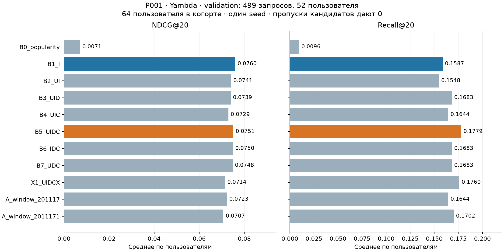

# P001 — локальный пилот построения признаков

Дата: 25 октября 2026 года. Статус: завершён. **Это development-пилот, а не итоговый отчёт работы 1.**

Сквозной процесс подготовки историй, генерации кандидатов, причинных агрегатов,
CatBoost и оценки работает локально. На этой небольшой выборке признаки объектов
дали лучший NDCG@20, а полный U/I/D/C — лучший Recall@20. Дополнительное затухание
и альтернативные окна не улучшили основной критерий. Статистическая устойчивость
различий этим запуском не установлена.

## Данные и постановка

Источник: [Yambda](https://huggingface.co/datasets/yandex/yambda), опубликованный
вариант 50M, revision `dd6f3a19eef5866e346c3270e098baa641a44948`.
В исходной таблице 47 790 449 событий. Seed 20261025; равновероятно выбраны
64 пользователя, сохранены все их 318 157 событий в этом варианте: 46 678 объектов.
Полнота относительно Yambda-5B не установлена. Глобальные популярности и каталог
вычисляются внутри выбранной когорты. Покрытие объектов связями artist — 99,719%,
album — 98,794%; связи дедуплицированы. Предполагается доступность фиксированного
снимка справочников на момент рекомендации.

Цель — зарегистрированный listen в момент запроса. Запросы задаются по listen,
а неоднозначные группы с несколькими listen одного пользователя в одно время
исключаются: 10 515 train-групп и 4 069 validation-групп. Это оценка logged targets,
не CTR по показам и не доказательство причинного эффекта рекомендаций.

Время используется в исходных единицах. Границы вычислены по квантилям времён
выбранной офлайн-когорты, а не заданы календарными датами:

- train-запросы: `9 752 280 ≤ t < 20 125 775`;
- validation: `20 125 775 ≤ t < 23 380 165`;
- последний период `t ≥ 23 380 165` зарезервирован для итоговой оценки.

Перед запросом видны только события с `timestamp < t`; равные метки не видят
друг друга. Истории не сокращаются при отборе запросов. Максимум 30 train и 10
validation запросов на пользователя: получены 1 349 train и 499 validation,
в validation представлены 52 пользователя. До ограничения числа запросов
доступны 85 343 и 32 062 однозначных запроса соответственно. Результаты относятся
к выбранным 499 запросам. Финальные played ratio, длина и текущий organic flag
не используются как признаки; доступность прошлых событий по logged timestamp
остаётся явным допущением replay.

## Кандидаты и обучение

Фиксированный генератор использует прошлую популярность, повторные треки,
предпочитаемых исполнителей и альбомы, квоты 25/25/35/15, максимум 100 объектов.
В validation получилось ровно 100 кандидатов на запрос. Целевой объект не
добавляется принудительно. Один и тот же набор кандидатов используется во всех
сравнениях; пропущенный target остаётся в знаменателе и даёт нулевое качество.

В обучении target найден для 349 из 1 349 запросов. Эти 349 запросов дают
34 900 строк: один положительный объект и 99 остальных кандидатов в каждом.
Остальные 1 000 запросов в обучение классификатора не входят. Остальные кандидаты
являются неотмеченными, а не подтверждёнными отрицательными предпочтениями.
Это условная выборка с balanced weights; предсказания не трактуются как
калиброванная вероятность естественного отклика.

Для всех обучаемых вариантов: CatBoostClassifier, Logloss, 120 итераций, depth=5,
learning_rate=0.07, l2=5, два CPU-потока, общий seed. U — история пользователя;
I — популярность/давность объекта и степени mapping; D — история пары;
C — профили исполнителей и альбомов с вкладом `1/k` для k уникальных связей.
Полный основной набор содержит 66 признаков. X добавляет 26 признаков затухания.
ID напрямую в бустинг не передаются.

Ручное короткое окно — 670 390 исходных единиц; ограниченный поиск проверяет
ещё 201 117 и 2 011 171. Half-life X — 670 390. Это три варианта окна,
а не полноценная автоматизация поиска связей, агрегатов и сочетаний признаков.

## Качество на validation

Основной критерий выбора — **user-macro NDCG@20**. Сначала метрика усредняется
по запросам пользователя, затем по 52 пользователям. Recall@20 для одной цели —
попадание в первые 20; NDCG учитывает позицию. Ничьи разрешаются по item ID.
Время в таблице относится только к обучению модели.

| Вариант | Признаков | NDCG@20 | Recall@20 | Обучение, с |
| --- | ---: | ---: | ---: | ---: |
| B0_popularity | 1 | 0.007139 | 0.009615 | 0.000 |
| B1_I | 12 | 0.075981 | 0.158654 | 0.969 |
| B2_UI | 22 | 0.074114 | 0.154808 | 1.447 |
| B3_UID | 32 | 0.073940 | 0.168269 | 1.781 |
| B4_UIC | 56 | 0.072926 | 0.164423 | 2.252 |
| B5_UIDC | 66 | 0.075126 | 0.177885 | 2.490 |
| B6_IDC | 56 | 0.074954 | 0.168269 | 2.304 |
| B7_UDC | 54 | 0.074809 | 0.168269 | 2.249 |
| X1_UIDCX | 92 | 0.071435 | 0.175962 | 3.314 |
| A_window_201117 | 66 | 0.072316 | 0.164423 | 2.289 |
| A_window_2011171 | 66 | 0.070728 | 0.170192 | 2.544 |



Наибольший NDCG@20 у B1_I: 0,075981. Полный B5_UIDC: 0,075126,
но Recall@20 выше: 0,177885 против 0,158654. Малые различия между
бустингами не позволяют объявить устойчивое преимущество. X и два альтернативных
окна основной критерий не улучшили. Выбор и сравнение сделаны на development-данных,
один seed; доверительные интервалы и повторные когорты пока не рассчитаны.

## Ограничение генератора кандидатов

Target найден в 130 из 499 запросов: **query-micro candidate recall 26,0521%**.
369 targets пропущены, включая 70 объектов, ещё не известных в выбранной истории.
Этот показатель имеет другой способ усреднения, чем user-macro метрики выше;
его нельзя напрямую использовать как их численный верхний предел.

| Тип цели | Запросов | Target найден | Candidate recall, query-micro |
| --- | ---: | ---: | ---: |
| Повторная для пользователя | 334 | 125 | 0.374251 |
| Новая для пользователя | 165 | 5 | 0.030303 |
| Уже известная в когорте | 429 | 130 | 0.303030 |
| Ещё неизвестная в когорте | 70 | 0 | 0 |

Строки повторная/новая и известная/неизвестная — два разных разбиения.
Генератор особенно редко находит новые для пользователя треки; ранжирование
не может исправить отсутствие target среди кандидатов. Следующий приоритет —
проверить retrieval и перенести сравнения на более представительную когорту,
сохранив одинаковые кандидаты внутри каждого сравнения признаков.

## Время и память

Подготовка данных заняла 8,276 с по отдельному таймеру. Основной runner —
**198.517 с**, включая три построения признаков и 10 обучений
(плюс popularity). Эти таймеры не включают написание кода и установку зависимостей.

| Короткое окно, raw | Построение, с | Строк матрицы | Столбцов | Матрица, МиБ |
| --- | ---: | ---: | ---: | ---: |
| 201117 | 51.328 | 184,800 | 92 | 64.856 |
| 2011171 | 54.558 | 184,800 | 92 | 64.856 |
| 670390 | 51.964 | 184,800 | 92 | 64.856 |

Матрица включает 1 848 запросов × 100 кандидатов; обучающие строки с retrieval miss
позже исключаются. Построение признаков занимает основную часть времени;
каждое обучение — около 1–3 с. Replay наблюдал 270 367 событий до конца validation.

Пиковая память процесса runner: **715.84 МиБ**;
минимум свободной системной памяти: **208.83 МиБ**.
Монитор с интервалом 0,25 с дополнен Windows peak working set. Пороги остановки
1 100 МиБ процесса и 150 МиБ свободной памяти не сработали. Пик отдельного
процесса подготовки данных не измерялся. CatBoost выдавал предупреждения
`used_ram_limit=512mb`: это мягкая настройка, фактическая память процесса выше.

Локальных ресурсов для этого пилота хватило; VPS сейчас не требуется.
Свободной RAM оставалось мало. Масштабирование требует измерений и оптимизации,
линейный прогноз на весь 50M по этим значениям не делаем.

## Проверки и границы выводов

23 синтетических теста прошли: временные границы, полнота выбранных историй,
mapping, причинные признаки, дробный вклад, decay, знаменатели и ничьи.
Независимый Luna-субагент пересчитал полное дерево метрик B1_I и B5_UIDC
из сохранённых predictions с совпадением до `1e-12`; проверил IDs/offsets
10 файлов и контрольные суммы подготовленных данных.
См. [рецензию результатов](../research/PILOT_RESULT_REVIEW.md).

Процедурное отклонение проверки: для вспомогательной проверки доступности
кандидатов субагент прочитал item_id/timestamp всего подготовленного файла,
включая зарезервированный период. Отклонение зафиксировано; test-метрики
не вычислялись, эти строки не использованы для обучения/ранжирования или
подбора вариантов. Проверка не была полностью изолирована от чтения test.

Дополнительные ограничения: небольшая когорта; один seed; исключение неоднозначных
listen-групп; ограничение запросов на пользователя; условное обучение; фиксированный
снимок mapping; raw-время; каталог только по когорте; отсутствие показов и
экспозиционных меток; подбор на validation. Полный статистический аудит исходного
50M не завершён. **Инструментальная проверка не заменяет требуемую человеческую
проверку фактов; её статус ведётся в [SOURCES.md](../../SOURCES.md).**

## Воспроизведение и артефакты

Из корня `D:\bot\T-Lab`, с уже загруженными исходными данными:

```powershell
py -3.12 -m venv .venv
.\.venv\Scripts\python.exe -m pip install -r task_01_auto_features/requirements-pilot.lock.txt
.\.venv\Scripts\python.exe task_01_auto_features/src/pilot_data.py --users 64 --seed 20261025 --output artifacts/pilot_001/data
.\.venv\Scripts\python.exe -m unittest discover -s task_01_auto_features/tests -p 'test_pilot*.py' -v
.\.venv\Scripts\python.exe -u task_01_auto_features/src/run_pilot.py
.\.venv\Scripts\python.exe task_01_auto_features/src/report_pilot.py
```

Последняя команда пересоздаёт только отчёт/CSV/график из готовых результатов,
без обучения и чтения тестовых событий. Повторное обучение выполняйте в копии
папки проекта, чтобы сохранить артефакты этого запуска.

- [Протокол до обучения](../configs/PILOT_PROTOCOL.md) и [конфигурация](../configs/pilot_001.json).
- [Замороженные метрики](pilot_001_snapshot/metrics.json), [CSV](pilot_001_metrics.csv), [SVG](pilot_001_comparison.svg).
- [Статус, хеши кода и данных](pilot_001_snapshot/run_status.json).
- [Контрольная точка P001](pilot_001_snapshot/README.md), [структура итогового отчёта](REPORT_OUTLINE.md).
- [Описание подготовки данных](../research/PILOT_DATA.md) и [признаков](../research/PILOT_FEATURES.md).
- Сохранены `queries.jsonl`, `models/*.cbm`, `predictions/*.npz`, `feature_build_*.json` в `artifacts/pilot_001/`.

SHA256 исходного `metrics.json` этого отчёта: `06e5c34d9d625a5c3cacaf0d3628def5282f4a4e4ef79c706d34d60743f083cc`.

## Следующий этап работы 1

1. Проверить календарную семантику времени, происхождение 50M и доступность метаданных.
2. Разобрать retrieval по новым/повторным объектам и проверить улучшенный генератор.
3. Оптимизировать построение признаков, затем измерить ступень 256–1 000 пользователей
   с полными доступными историями и несколькими seed/когортами.
4. Реализовать ограниченный бюджетом поиск связей, агрегатов и окон, сопоставить
   с сильным ручным набором, включая отдельные artist/album абляции.
5. После фиксации метода выполнить единственную итоговую оценку на test и подготовить
   полный исследовательский отчёт. Работа 2 начнётся после завершения работы 1.
